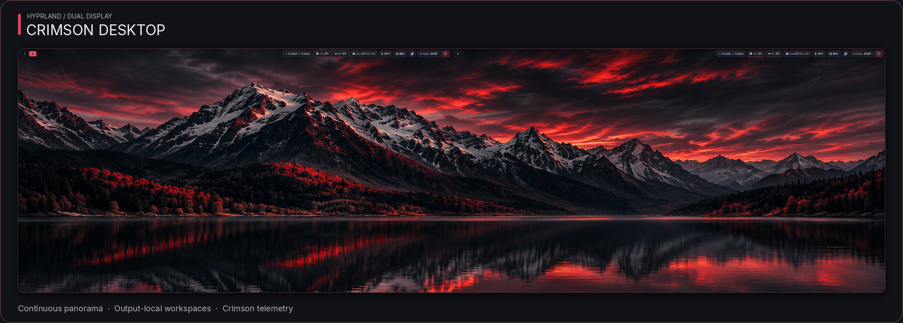
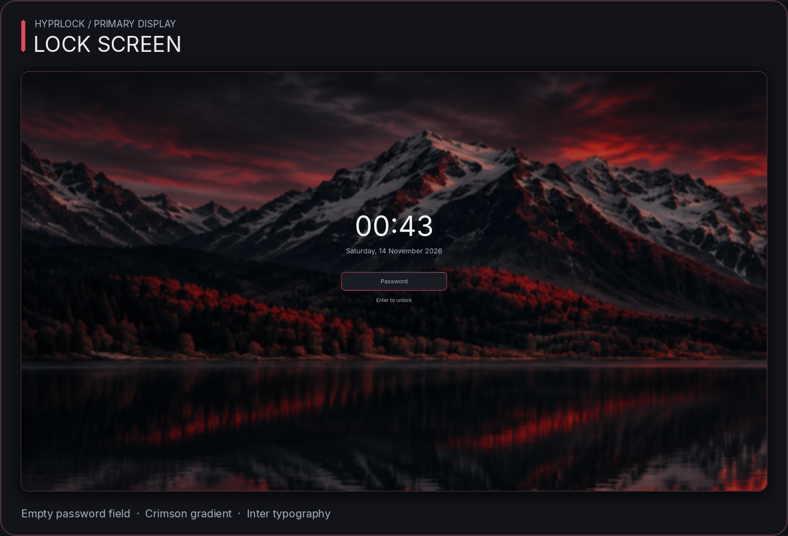
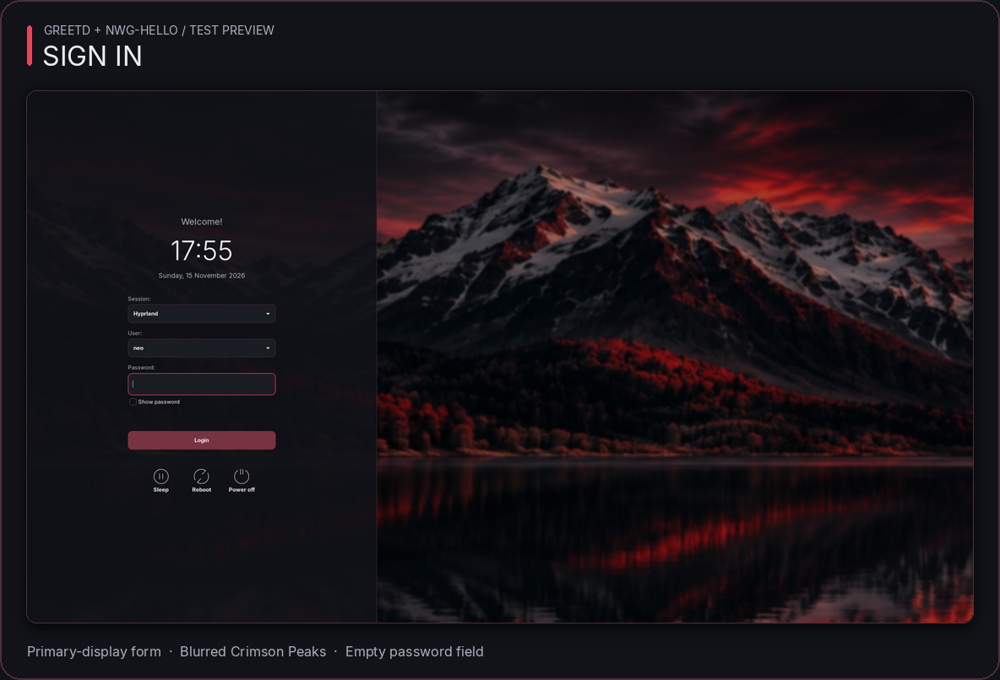

# Crimson Desktop

**Arch Linux · Hyprland · Graphite & crimson · Dual-display panorama**



<table>
  <tr>
    <td width="50%"></td>
    <td width="50%"></td>
  </tr>
</table>

*Existing controlled captures, framed and resized for this gallery—not new
screenshots of the current workspace. The greeter image is a test-mode preview.
See [screenshot provenance and privacy](docs/screenshots.md).*

## The setup

| Component | Choice | Configuration / notes |
|---|---|---|
| Compositor | Hyprland, Dwindle | [Lua config](home/.config/hypr/hyprland.lua); crimson gradient borders |
| Displays | Lenovo DP-1 + Dell HDMI-A-2 | 2560×1440 each, approximately 180 Hz + 75 Hz |
| Status bar | Waybar | [Layout + CSS](home/.config/waybar/); output-local workspaces and titles |
| GPU telemetry | Custom Python helper | [gpu.py](home/.config/waybar/scripts/gpu.py); pinned discrete AMD GPU, 5-second sampling |
| Launcher & power menu | Rofi | [Shared Crimson themes](home/.config/rofi/) + [power helper](home/.local/bin/powermenu) |
| Terminal | Kitty | [Opaque graphite palette](home/.config/kitty/), JetBrains Mono 11 |
| Shell & prompt | Zsh + Starship | [.zshrc](home/.zshrc) + [contextual two-line prompt](home/.config/starship.toml) |
| Lock screen | Hyprlock | [Password field on Lenovo only](home/.config/hypr/hyprlock.conf); time/date on both outputs |
| Idle management | Hypridle | [600-second lock / 900-second DPMS](home/.config/hypr/hypridle.conf) |
| Notifications | Mako | [Crimson styling](home/.config/mako/config), approximately five-second timeout |
| Wallpaper | Hyprpaper | [Native panorama halves](home/.local/share/wallpapers/crimson/) + [output mapping](home/.config/hypr/hyprpaper.conf) |
| Login screen | greetd + nwg-hello | [Crimson greeter](system/etc/nwg-hello/); Lenovo-only form, Dell wallpaper-only |
| GTK appearance | adw-gtk3-dark | [GTK3](home/.config/gtk-3.0/settings.ini) / [GTK4](home/.config/gtk-4.0/settings.ini); selected [desktop preferences](manifest/appearance.json) |
| Icons & cursor | Flat-Remix-Red-Dark + Bibata-Modern-Classic | Cursor size 24 |
| Typography | Inter + JetBrains Mono | Desktop UI + terminal; Font Awesome / Nerd Font symbols in Waybar |
| Audio & network | PipeWire/WirePlumber + NetworkManager | Enablement inventory only; no private connection profiles |
| System preferences | zram, SSH daemon policy, Snapper timer, pacman, initramfs, UFW preferences | [Selected system files](system/etc/); manual-only restore |
| SATA storage | Crucial + Games ext4, UUID startup mounts, protected readable backup, weekly TRIM | [Storage recovery](docs/storage.md); reboot persistence test pending |

### Everyday shortcuts

| Keys | Action |
|---|---|
| Super + arrows | Change window focus |
| Super + Shift + arrows | Rearrange tiled windows within the current screen |
| Super + Q | Kitty |
| Super + R | Application launcher |
| Super + E | Thunar |
| Super + L | Lock screen |
| Super + 1…0 | Switch workspace |
| Super + Shift + 1…0 | Move window to workspace |
| Super + mouse drag / right-drag | Move / resize window |

## What this repository does

Copy-based snapshot of the working Arch + Hyprland **Crimson Desktop**.
Live configuration stays in its original location: no symlinks, auto-commits,
push automation, service restarts or restore actions.

**Current status (2026-11-17):** Phase A was committed before the SATA work.
The SATA migration, restored-file SHA-256 verification, startup mount checks,
protected Apacer backup access, NVMe temporary-copy cleanup and weekly TRIM
configuration are complete. Actual reboot-persistence testing remains pending.
This storage-only update is explicitly authorized for commit/push on `develop`;
remote visibility is not verified. `develop` remains the source of truth.

Phase A adds a [sanitized system recovery inventory](docs/system-recovery-inventory.md),
[service prerequisites](docs/service-recovery-map.md), and a
[review-only mapping/image update procedure](docs/config-change-review.md).
Bootstrap implementation (Phase B) and disposable-system recovery rehearsal
(Phase C) require separate approval; neither has started.

## Layout

```text
manifest/configs.json       33 explicit live-source → repository mappings
manifest/packages-*.txt     explicit native and foreign package inventories
manifest/services.json     curated enabled system/user unit names
manifest/appearance.json   selected GSettings appearance values
manifest/screenshots.json  exact hashes/provenance of reviewed gallery images
scripts/sync-from-system   dry-run by default; --apply copies into this repo only
scripts/verify-manifest    validate sources, modes, hashes and planned changes
scripts/audit-repo         inspect working tree (also ignored files) + Git index
scripts/rollback-sync      dry-run by default; undo repository snapshot only
scripts/propose-inventories  print reviewed-shape inventories; never write them
scripts/inspect-recovery-policy  separately approved, sanitized privileged reads only
scripts/dotfiles.py         shared standard-library implementation
tests/test_workflow.py      disposable fake-home/Git-repo tests
tests/test_recovery.py      sanitized policy fixtures; no privileged/live commands
docs/                      security, dependencies, recovery and bootstrap design
home/                      approved copies, mirroring $HOME
system/                    approved copies, mirroring /
assets/screenshots/        three privacy-reviewed gallery images
```

Every source is an individual regular file. `home/` mirrors `$HOME`; `system/`
mirrors `/`. Three deployed wallpapers stay at their original relative paths,
without duplicate wallpaper derivatives. `assets/screenshots/` contains only
documentation images, not another deployment copy.

## Maintenance

Requirements: Python 3, Git, Linux. Run as your normal user, **never sudo**.

```sh
cd ~/Repos/dot-files
./scripts/sync-from-system --dry-run
./scripts/sync-from-system --dry-run --diff
./scripts/verify-manifest
```

After approving the proposed copies:

```sh
./scripts/sync-from-system --apply
./scripts/audit-repo
git diff --check
git status --short
git diff
```

Matching sources yield no changes; sandbox tests cover repeated apply behavior.
Any repeat real-system apply used for verification also requires approval.
New/untracked copies are absent from normal `git diff`: inspect them using
the sync `--diff`, your editor, and explicit staged review.

Day to day: edit live config deliberately → dry-run/diff → approve repo-only
apply → audit → review status, diff and new files → deliberate commit/push →
check the remote branch HEAD. New paths and PNG replacements need approval via
the [review procedure](docs/config-change-review.md); they are not auto-discovered.

**Only with separate staging/commit/push approval**, stage exact reviewed paths
(not a blanket `git add -A`), inspect `git diff --cached --stat` and
`git diff --cached`, run the audit again, then commit and push. `git add -p`
helps review updates to already tracked files, but does not normally add new ones.
No tool here stages, commits, pushes or modifies your SSH configuration.

Example review/publish sequence, **not executed by tooling** and requiring those
approvals:

```sh
git add -p
git diff --cached --stat
git diff --cached
./scripts/audit-repo
git diff --cached --check
git commit -m "Improve sanitized system recovery documentation"
git push origin develop
git ls-remote origin refs/heads/develop
```

Inspect new files explicitly before staging their exact paths. Never force-push
or assume a cached `origin/develop` ref proves the current GitHub HEAD.

Current remote: `git@github.com:justas-budginas/dot-files.git`.
Remote privacy has not been verified; private is recommended initially.
Git author name/email are configured; verify their suitability locally before committing.
Commit email can become public; GitHub's no-reply email is an option.

## Inventories are a separate review step

```sh
./scripts/propose-inventories
```

Prints proposals for explicit native packages, foreign packages (not necessarily
all from the AUR), enabled system/user units, and seven selected appearance
preferences. It never exports network connections, environments or dconf wholesale.
The initial proposals were reviewed and saved: 79 explicit native packages,
three foreign packages, 14 system units, six user units and seven appearance keys.
Review and explicitly approve saving any future replacement artifacts.
Routine configuration sync never refreshes inventories.

## Safety and limits

- Missing sources fail closed; no automatic deletions/pruning.
- Symlinks (including parent components), special files, oversized content,
  non-UTF8/binary text and recognizable credentials are refused.
- Live wallpapers must match current reviewed hashes and metadata-free chunks.
  Exact prior repo/index/rollback pins may be retained only after explicit review;
  no command refreshes image approvals.
- Previously synced repository edits/deletions and staged conflicting snapshots
  are protected. There is deliberately no force/overwrite flag.
- Copies use temporary files and atomic rename. Local transactions and rollback
  originals stay under `.git/dotfiles-sync/`, never tracked.
- An identical first run may adopt existing identical copies; divergent unmanaged
  copies are refused. After cloning, local transaction history is absent: review
  divergent copies manually rather than bypassing this guard.
- Heuristic scans cannot prove absence of secrets. Review filenames and content
  before each commit; private GitHub visibility is not a secret boundary.

See [security](docs/security.md), [setup/dependencies](docs/setup-notes.md),
[recovery](docs/recovery-notes.md), [verification](docs/verification.md) and
[future bootstrap](docs/bootstrap-roadmap.md).

The recovery inventory describes actual observed UFW/Snapper/Btrfs/GRUB/WoL
settings without copying private network profiles, disk identifiers or snapshot
data from that earlier observation. The separately approved storage update
publishes only the two SATA filesystem UUIDs in a narrow recovery fragment;
full fstab, hardware serials, personal inventories and checksum logs stay out of
Git. Observation is not proof that a fresh-machine restore has been rehearsed.

This is **not** a full backup of home, application state, disks, EFI or the OS.
